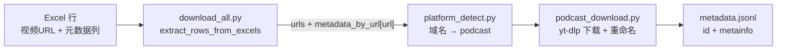

# Podcast 来源：URL、音频文件名与 metadata 的关系

本文档描述 `scripts` 架构中，**Podcast 来源**在「URL → 音频文件 → metadata」链路上的设计与实现要点。相关代码主要在：

- `scripts/download/download_all.py`（入口分发）
- `scripts/download/excel_urls.py`（Excel 读取）
- `scripts/download/platform_detect.py`（平台识别）
- `scripts/download/podcast_download.py`（播客下载与 metadata 写入）
- `scripts/download/yt_dlp_common.py`（archive、metadata 写入工具）

---

## 总体流水线

Podcast 不走 `url_crawl` 的专用爬虫（`crawl_all` 只覆盖 B 站 / YouTube）。播客条目通常来自 **已填好的 Excel**（人工或其它流程），再由下载入口统一处理：



核心约定：**metadata 内容来自 Excel，下载阶段不再 `yt-dlp -j` 抓元数据**（与 YouTube/B 站下载模块一致）。

---

## 1. 输入 URL 与 Excel metadata 的绑定

`excel_urls.extract_rows_from_excels` 以 **Excel 中的「视频URL」字符串** 为唯一主键：

| 结构 | 含义 |
|------|------|
| `urls` | 去重、保序的 URL 列表 |
| `metadata_by_url[url]` | `{"duration_s": ..., "metainfo": {...}}` |
| `metainfo` | 频道名、标题、主题、来源名称/类型、平台、发布时间、播放量等（见 `excel_urls._row_to_metainfo`） |

`download_all.py` 把整份 `metadata_by_url` 原样传给 `download_podcast(..., metadata_by_url=...)`，**关联键始终是 Excel 里那一行的 URL 文本**，不是文件名。

Excel 表头约定（与 `scripts/url_crawl/utils.py` 中 `HEADERS` 对齐）：

- 视频URL、频道名、时长(时分秒)、时长(小时)、主题、标题、来源名称、来源类型、平台、发布时间、播放量

---

## 2. 平台识别：哪些 URL 会进 podcast 分支

`platform_detect.detect_platform` 用 **域名子串** 判断（非 yt-dlp extractor）。

当前 `_PODCAST_DOMAINS` 包括但不限于：

- SBS Australia：`sbs.com.au`、`streamguys1.com`
- Spotify / Anchor：`anchor.fm`、`podcasters.spotify.com`
- 喜马拉雅：`ximalaya.com`
- 小宇宙：`xiaoyuzhoufm.com`
- SoundOn：`soundon.fm`
- Buzzsprout、Omny、Subsplash、Wavpub、Acast、SoundCloud
- 香港电台 RTHK、Firstory、荔枝 FM、Pod.co、RedCircle、Podtrac 等

规则要点：

- 命中上述域名 → `platform = "podcast"`
- 纯 `.mp3` 直链但域名 **不在** 列表里 → **`unknown`**，不会进 podcast 下载

---

## 3. URL 在下载前的变换（与 archive 的关系）

Podcast 模块里 URL 会经历几层「身份」，用途不同。

### 3.1 断点续跑：`url_to_archive_key(url) → (extractor, id)`

用于对照 `downloaded.txt`（yt-dlp `--download-archive`）预跳过，**不是最终文件名**。

| URL 类型 | archive 形态示例 |
|----------|------------------|
| SBS 节目页 | `("sbs", slug)` |
| Buzzsprout / Anchor / Spotify Podcasters 等 | 各平台正则抽出的 episode id |
| 音频直链（`.mp3` / `.m4a` / `.mp4` / `.wav` / `.ogg`） | `("podcast_direct", 路径文件名 stem)` |

无法解析的 URL 仍进入 `pending`，交给 yt-dlp 自行处理。

### 3.2 SBS 页面 → 音频直链（运行时改写）

对 `sbs.com.au/.../podcast-episode/...` 页面，下载前会并发抓 HTML，抽出 `.mp3` 等直链，**把 `pending` 里的 URL 替换成直链**：

- 目的：绕过 yt-dlp 对部分 SBS 页的 `Unsupported URL`
- 副作用：**实际下载 URL 可能与 Excel 里的节目页 URL 不一致**；archive  thereafter 更偏向 `podcast_direct` + 文件名 id

### 3.3 落盘路径模板

yt-dlp 输出模板固定为：

```
podcast/audio/%(id)s.%(ext)s
```

即：`downloads/<task_name>/podcast/audio/<yt-dlp的id>.wav`。

Podcast 分支 **强制** `audio_format=wav`（忽略全局 `--audio-format`）。

---

## 4. 保存的文件名：与 URL 的关系

下载后有一轮 **强制短文件名重命名**（避免过长路径）。

函数 `_short_podcast_id(seed)`：

- 对 `seed`（通常为匹配到的下载 URL）做 MD5
- 返回 `p` + 十六进制前 12 位，例如 `p1a2b3c4d5e6f7`

流程简述：

1. yt-dlp 先写出 `podcast/audio/{平台id}.wav`（`%(id)s` 来自 extractor）
2. 用「旧 stem 是否出现在某条 `pending` URL 中」**尽力**反查来源 URL
3. 重命名为：`podcast/audio/p{md5(来源URL)[:12]}.wav`（碰撞时再对复合 seed 重算）

| 阶段 | 文件名 stem 通常对应 |
|------|---------------------|
| yt-dlp 刚落盘 | 平台 episode id / 直链文件名 |
| 重命名后 | `p` + MD5(匹配到的 pending URL)[:12] |

设计意图：最终磁盘上的 **`id` = `p` + 对「下载时用的 URL」的 MD5 前 12 位**，与平台 slug 解耦，路径稳定且短。

---

## 5. `metadata.jsonl`：如何把文件挂回 Excel

仅对 **本轮新增** 且位于 `podcast/audio/` 下的文件写入。每条记录由 `write_metadata_entry` 生成，形态如下：

```json
{
  "id": "<文件 stem，多为 pxxxxxxxxxxxx>",
  "duration_s": 123.45,
  "metainfo": {
    "platform": "podcast",
    "url": "<匹配到的 URL>",
    "channel": "...",
    "title": "...",
    "topic": "...",
    "source_name": "...",
    "source_type": "...",
    "publish_date": "...",
    "view_count": null
  }
}
```

- `duration_s`：来自 Excel「时长(小时)」或「时长(时分秒)」
- `metainfo` 中除 `platform`、`url` 外均来自 Excel 行映射
- `platform`、`url` 由下载侧写入并覆盖同名字段，保证权威

### 文件 → Excel 的关联逻辑（按优先级）

实现见 `podcast_download.py` 中 metadata 写入段：

1. **archive key 精确匹配**：`url_to_archive_key(Excel URL)` 的 `id` == 文件 `stem`
2. **直链 id 索引**：`podcast_direct` 的文件名 stem
3. **子串兜底**：`stem in url`（适合 yt-dlp id 仍留在 URL 里、且未成功短重命名的情况）

### 架构张力（实现时需注意）

- 重命名后 `stem` 变为 `p{md5...}`，**一般不会再出现在 URL 子串里**，步骤 1/3 对「已重命名」文件往往对不上。
- Excel 键是 **原始节目页 URL**，SBS 预解析后 **pending 可能是直链 URL**，archive / 反查键也会偏向直链侧。
- 重命名阶段维护了 `url_by_new_vid[new_stem] = src_url`，但 **metadata 写入段当前未使用该映射**；若三步都失败，仍会写入 `metadata.jsonl`，但 `metainfo` 可能只剩 `platform`/`url` 空壳。

### 理想关系（设计目标）

```
Excel「视频URL」 ──metadata_by_url──► metainfo 字段
        │
        ├─►（可选）SBS 页面 → 音频直链（实际下载 URL）
        │
        └─► MD5(实际下载 URL) ──► 文件名 id = p{md5[:12]}
                                    │
                                    └─► metadata.jsonl 的 "id"
```

---

## 6. 与 YouTube/B 站的差异（Podcast 特有）

| 维度 | Podcast |
|------|---------|
| 元数据来源 | 仅 Excel，无 `yt-dlp -j` |
| 输出格式 | 固定 WAV（忽略全局 `--audio-format`） |
| 输出目录 | `podcast/audio/`（非 `youtube/`、`bilibili/`） |
| Cookies | 不传（`cookies_path=""`） |
| 文件名 | 下载后统一短 id 重命名 |
| `url_crawl` | 无播客专用爬虫，Excel 需事先具备 URL 与列 |

---

## 7. 辅助落盘文件（便于排查）

| 文件 | 内容 |
|------|------|
| `downloads/<task>/urls.txt` | 本任务全部 URL |
| `podcast_urls.txt` | 本批 podcast URL |
| `podcast_urls_pending.txt` | 经 archive 过滤后待下载 URL（含 SBS 改写后） |
| `downloaded.txt` | yt-dlp archive：每行 `extractor id` |
| `metadata.jsonl` | 追加式 JSONL，一条对应一个成功关联的新音频文件 |
| `downloads.log.jsonl` | 下载运行日志 |

---

## 8. 一句话归纳

**Excel 的「视频URL」是 metadata 的主键；下载时 URL 可能被解析/改写（尤其 SBS）；磁盘文件最终以 `podcast/audio/p{md5(URL)[:12]}.wav` 命名；`metadata.jsonl` 的 `id` 等于该文件名 stem，`metainfo` 其余字段来自 Excel，通过 archive id / URL 子串等启发式把文件反查回 Excel 行——在 URL 被改写或已完成短 id 重命名时，这条反查链是最脆弱的一环。**

---

## 相关入口命令

```bash
python scripts/download/download_all.py --excel path/to/metadata.xlsx --out downloads --task-name my_task
```

Podcast URL 会随 `platform_detect.split_urls_by_platform` 自动进入 `download_podcast`。
