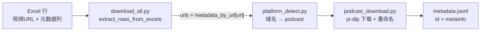

# Podcast 来源：URL、音频文件名与 Metadata 的关系

本文档说明 `scripts` 架构中，**Podcast/播客来源** 在「Excel URL → 下载音频文件 → `metadata.jsonl`」链路上的设计与实现要点。主要代码位于：

- `scripts/download/download_all.py` — 入口与分发
- `scripts/download/excel_urls.py` — 从 Excel 读取 URL 与行级元信息
- `scripts/download/platform_detect.py` — 平台识别
- `scripts/download/podcast_download.py` — Podcast 下载与 metadata 写入
- `scripts/download/yt_dlp_common.py` — archive、metadata 写入辅助函数

---

## 总体流水线

Podcast **不走** `url_crawl` 的专用爬虫（`crawl_all` 仅覆盖 B 站 / YouTube）。播客条目通常来自 **已填好的 Excel**（人工或其它流程），再由下载入口统一处理：



**核心约定**：metadata 内容来自 Excel，下载阶段 **不再** 调用 `yt-dlp -j` 抓取元数据（与 YouTube/B 站下载模块一致）。

---

## 1. 输入 URL 与 Excel Metadata 的绑定

`excel_urls.extract_rows_from_excels` 以 **Excel 中的「视频URL」字符串** 为唯一主键：

| 结构 | 含义 |
|------|------|
| `urls` | 去重、保序的 URL 列表 |
| `metadata_by_url[url]` | `{"duration_s": ..., "metainfo": {...}}` |
| `metainfo` | 频道名、标题、主题、来源名称/类型、平台、发布时间、播放量等（见 `excel_urls._row_to_metainfo`） |

`download_all.py` 把整份 `metadata_by_url` 原样传给 `download_podcast(..., metadata_by_url=...)`。**关联键始终是 Excel 里那一行的 URL 文本**，不是文件名。

### Excel 表头约定

与 `scripts/url_crawl/utils.py` 中 `HEADERS` 对齐，例如：

`视频URL`, `频道名`, `时长(时分秒)`, `时长(小时)`, `主题`, `标题`, `来源名称`, `来源类型`, `平台`, `发布时间`, `播放量`

`duration_s` 优先使用「时长(小时)」列（浮点 × 3600），其次解析「时长(时分秒)」字符串。

---

## 2. 平台识别：哪些 URL 会进入 Podcast 分支

`platform_detect.detect_platform` 通过 **域名子串** 判断（非 yt-dlp extractor）。

常见 Podcast 域名包括（完整列表见 `platform_detect._PODCAST_DOMAINS`）：

- SBS：`sbs.com.au`、`streamguys1.com`
- Spotify / Anchor：`anchor.fm`、`podcasters.spotify.com`
- 喜马拉雅：`ximalaya.com`
- 小宇宙：`xiaoyuzhoufm.com`
- SoundOn：`soundon.fm`
- Buzzsprout、Acast、SoundCloud、Omny、Podbean 等

**注意**：纯 `.mp3` 直链若域名不在上述列表中 → 归类为 **`unknown`**，不会进入 `download_podcast`。

---

## 3. URL 在下载前的变换（与 archive 的关系）

Podcast 模块里，同一逻辑 URL 会经历几层「身份」，用途各不相同。

### 3.1 断点续跑：`url_to_archive_key(url) → (extractor, id)`

用于对照 `downloaded.txt`（yt-dlp `--download-archive`）做预跳过。**这不是最终文件名**。

| URL 类型 | archive 形态示例 |
|----------|------------------|
| SBS 节目页 | `("sbs", slug)` |
| Buzzsprout / Anchor / Spotify Podcasters 等 | 各平台正则抽出的 episode id |
| 音频直链（`.mp3` / `.m4a` / …） | `("podcast_direct", 路径文件名 stem)` |

无法解析的 URL 仍保留在 `pending`，交给 yt-dlp 自行判断。

实现见 `podcast_download.url_to_archive_key`。

### 3.2 SBS 页面 → 音频直链（运行时改写）

对 `sbs.com.au/.../podcast-episode/...` 页面，下载前会并发请求 HTML，从中抽出 `.mp3` 等直链，**将 `pending` 中的 URL 替换为直链**：

- **目的**：绕过 yt-dlp 对部分 SBS 页的 `Unsupported URL`
- **副作用**：实际下载 URL 可能与 Excel 中的节目页 URL **不一致**；后续 archive 更偏向 `podcast_direct` + 文件名 id

实现见 `podcast_download._resolve_sbs_audio_url`。

### 3.3 落盘路径模板

yt-dlp 输出模板固定为：

```
podcast/audio/%(id)s.%(ext)s
```

即：`downloads/<task_name>/podcast/audio/<yt-dlp的id>.wav`

Podcast 分支 **强制** `audio_format=wav`（忽略全局 `--audio-format`）。

---

## 4. 保存的文件名：与 URL 的关系

下载完成后有一轮 **强制短文件名重命名**（避免过长路径 / 路径问题）。

### 短 ID 生成规则

```python
def _short_podcast_id(seed: str) -> str:
    return "p" + hashlib.md5(seed.encode("utf-8")).hexdigest()[:12]
```

### 重命名流程

1. yt-dlp 先写出 `podcast/audio/{平台id}.wav`（`%(id)s` 来自各平台 extractor）
2. 用「旧 stem 是否出现在某条 `pending` URL 中」**尽力**反查来源 URL
3. 重命名为：`podcast/audio/p{md5(来源URL)[:12]}.wav`（若发生碰撞，对复合 seed 再算一次）

| 阶段 | 文件名 stem 通常对应 |
|------|---------------------|
| yt-dlp 刚落盘 | 平台 episode id / 直链文件名 |
| 重命名后 | `p` + MD5(匹配到的 pending URL)[:12] |

**设计意图**：磁盘上的 canonical **`id`** = 对「下载时使用的 URL」取 MD5 的短前缀，与平台 slug 解耦，路径稳定且短。

重命名阶段会维护 `url_by_new_vid[new_stem] = src_url`，供内部映射使用。

---

## 5. `metadata.jsonl`：如何把文件挂回 Excel

仅对 **本轮新增**、且位于 `podcast/audio/` 下的文件写入。每条记录由 `yt_dlp_common.write_metadata_entry` 追加生成：

```json
{
  "id": "<文件 stem，多为 pxxxxxxxxxxxx>",
  "duration_s": 123.45,
  "metainfo": {
    "platform": "podcast",
    "url": "<匹配到的 URL>",
    "channel": "...",
    "title": "...",
    "topic": "...",
    "source_name": "...",
    "source_type": "...",
    "publish_date": "...",
    "view_count": null
  }
}
```

- `metainfo.platform` 与 `metainfo.url` 由下载侧 **覆盖** 写入，保证权威。
- 其余字段来自 Excel 行映射。

### 文件 → Excel 行的关联逻辑（按优先级）

实现见 `podcast_download.download_podcast` 中 metadata 写入段：

1. **archive key 精确匹配**：对 Excel URL 调用 `url_to_archive_key`，若其 `id` == 文件 `stem`，则命中
2. **直链 id 索引**：`podcast_direct` 类型下，用直链文件名 stem 反查
3. **子串兜底**：`stem in url`（适用于 yt-dlp id 仍出现在 URL 中、且未成功短重命名的情况）

### 已知架构张力（实现时注意）

- 重命名后 `stem` 变为 `p{md5...}`，**通常不会**再出现在 URL 子串中，步骤 1/3 对「已重命名」文件可能失效。
- Excel 主键是 **原始节目页 URL**，而 SBS 预解析后 **pending 可能是音频直链**，archive / 反查键会偏向直链侧。
- 重命名阶段维护了 `url_by_new_vid`，但 metadata 写入段 **当前未直接使用该映射**；若三步均失败，仍会写入 `metadata.jsonl`，但 `metainfo` 可能仅剩空的 `platform` / `url`。

### 理想关系（设计目标）

```
Excel「视频URL」 ──metadata_by_url──► metainfo 字段
        │
        ├─►（可选）SBS 页面 → 音频直链（实际下载 URL）
        │
        └─► MD5(实际下载 URL) ──► 文件名 id = p{md5[:12]}
                                    │
                                    └─► metadata.jsonl 的 "id"
```

---

## 6. 与 YouTube / B 站的差异（Podcast 特有）

| 维度 | Podcast |
|------|---------|
| 元数据来源 | 仅 Excel，无 `yt-dlp -j` |
| 输出格式 | 固定 WAV |
| 输出目录 | `podcast/audio/` |
| Cookies | 不传（`cookies_path=""`） |
| 文件名 | 下载后统一短 id 重命名 |
| `url_crawl` | 无播客专用爬虫，Excel 需事先具备 URL 与列 |

---

## 7. 辅助落盘文件（便于排查）

| 文件路径（相对 `downloads/<task_name>/`） | 内容 |
|------------------------------------------|------|
| `urls.txt` | 本任务全部 URL |
| `podcast_urls.txt` | 本批 podcast URL（传入的完整列表） |
| `podcast_urls_pending.txt` | 经 archive 过滤后待下载 URL（含 SBS 改写后） |
| `downloaded.txt` | yt-dlp archive，每行 `extractor id` |
| `downloads.log.jsonl` | 下载运行日志 |
| `metadata.jsonl` | 追加式 JSONL，一条对应一个写入 metadata 的新音频文件 |

---

## 8. 一句话归纳

**Excel 的「视频URL」是 metadata 的主键；下载时 URL 可能被解析/改写（尤其 SBS）；磁盘文件最终以 `podcast/audio/p{md5(URL)[:12]}.wav` 命名；`metadata.jsonl` 的 `id` 等于该文件名 stem，`metainfo` 其余字段来自 Excel，通过 archive id / URL 子串等启发式把文件反查回 Excel 行——在 URL 被改写或已完成短 id 重命名时，这条反查链是最脆弱的一环。**

---

## 相关代码索引

| 功能 | 文件 | 符号 |
|------|------|------|
| 入口分发 | `scripts/download/download_all.py` | `main()` → `download_podcast` |
| Excel 读取 | `scripts/download/excel_urls.py` | `extract_rows_from_excels` |
| 平台识别 | `scripts/download/platform_detect.py` | `detect_platform`, `_PODCAST_DOMAINS` |
| Podcast 下载 | `scripts/download/podcast_download.py` | `download_podcast`, `url_to_archive_key` |
| Metadata 写入 | `scripts/download/yt_dlp_common.py` | `write_metadata_entry`, `filter_urls_by_archive` |
